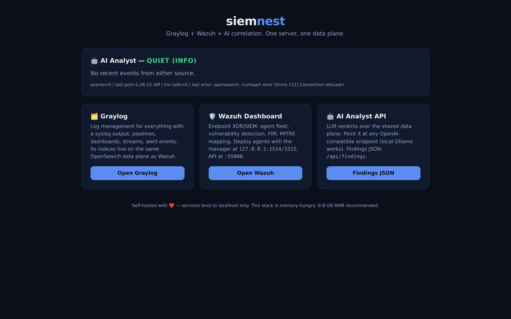

<div align="center">

# siemnest

**Graylog + Wazuh + AI correlation on one server, one data plane, one command.**

One integrated SOC stack: [Graylog](https://github.com/Graylog2/graylog2-server) for log management, [Wazuh](https://github.com/wazuh/wazuh) for endpoint XDR/SIEM, a **single shared OpenSearch data plane**, and an **AI analyst** that correlates events from both and publishes verdicts.

[](https://github.com/OneByJorah/siemnest/actions/workflows/ci.yml)
[](https://www.docker.com/)
[](https://opensource.org/licenses/MIT)



</div>

## The Integration

What makes this one project instead of two installs:

- **One shared data plane.** Wazuh's indexer is OpenSearch 2.x with Wazuh plugins — Graylog 6 writes its indices to that same cluster (`GRAYLOG_ELASTICSEARCH_HOSTS` points at `wazuh-indexer:9200`). One datastore, one query surface, half the infrastructure of running each tool separately.
- **AI correlation across both.** The bundled `ai-analyst` service polls security events (Wazuh alert indices) and log events (Graylog streams) through the shared store, sends the correlated batch to any OpenAI-compatible LLM (local Ollama works out of the box), and publishes verdicts to the portal.
- **One portal.** Live AI verdict, links to both consoles, service status.

## Stack

| Service | Upstream | Role | Port (localhost) |
| ------- | -------- | ---- | ---------------- |
| **Wazuh manager** | `wazuh/wazuh-manager` | Agent fleet, FIM, vulnerability detection | `1514/1515/55000` |
| **Wazuh indexer** | `wazuh/wazuh-indexer` | OpenSearch 2.x + Wazuh plugins — **shared data plane** | internal `9200` |
| **Wazuh dashboard** | `wazuh/wazuh-dashboard` | Security UI | `443` |
| **Graylog** | `graylog/graylog` | Log management, pipelines, alerts — backend on the shared indexer | `9000` |
| **MongoDB** | `mongo:7.0` | Graylog metadata | internal |
| **AI analyst** | built from `ai-analyst/` | LLM correlation over both sources | `8090` |
| **Portal** | built from `portal/` | Landing page + AI verdict feed | `8080` |

## How The Apps Were Analyzed

Packaging decisions were grounded in REA (Reverse Engineer Anything) static
analysis:

- **graylog2-web-interface `src/`** — 4,147 files, 1,361,454 AST nodes, 27,070 findings, 0 parse failures. Evidence `ev_1c8758904d0a201f4b11ae310689322cc4011b2446d303f`.
- **wazuh `src/`** — Wazuh's core is C/C++ + Python (native route); its server-side data contract (`INDEXER_URL`, credentials, Filebeat output) was taken from its deployment configuration, since REA's JavaScript analysis does not apply to its native core.
- **kumaalert-style notification pattern** — see the twinops project for the ntfy push route.

## Quick Start

```bash
git clone https://github.com/OneByJorah/siemnest.git
cd siemnest
./install.sh          # creates .env and tells you exactly what to fill in
```

Required in `.env` (generate with `openssl rand -hex`):

- `INDEXER_ADMIN_PASSWORD`, `DASHBOARD_PASSWORD`
- `GRAYLOG_PASSWORD_SECRET` (≥64 chars), `GRAYLOG_ROOT_PASSWORD_SHA2` (`echo -n 'pw' | sha256sum`)

Then:

```bash
docker compose up -d --build
```

First boot is heavy (image pulls + indexer bootstrap) — give it 5-10 minutes, then:

| Surface | URL |
| ------- | --- |
| Portal | `http://127.0.0.1:8080` |
| Graylog | `http://127.0.0.1:9000` (login `admin` + your `GRAYLOG_ROOT_PASSWORD_SHA2` source password) |
| Wazuh Dashboard | `https://127.0.0.1:443` (accept the self-signed cert; `admin` + `INDEXER_ADMIN_PASSWORD`) |
| AI findings | `http://127.0.0.1:8090/api/findings` |

## AI Capability

The analyst is LLM-agnostic — anything speaking the OpenAI chat-completions API:

- **Local:** run Ollama on the host, keep the default `LLM_BASE_URL=http://host.docker.internal:11434/v1`, set `LLM_MODEL`.
- **Hosted:** point `LLM_BASE_URL`/`LLM_API_KEY` at any provider.
- **No LLM?** It falls back to a deterministic heuristic digest so the pipeline still works.

It polls every `POLL_SECONDS` (default 60), correlates Wazuh rule hits with
Graylog log context, and classifies the batch (`quiet / normal / attention /
critical`). Verdicts are served as JSON at `/api/findings` and rendered live on
the portal.

## Resource Requirements

The full stack wants **6-8 GB RAM** beyond your OS (JVMs on both sides).
Tune `OPENSEARCH_JAVA_OPTS` in `docker-compose.yml` for smaller hosts.

## Security Notes

- No secrets in the repo; `.env` is gitignored, `.env.example` ships placeholders.
- All services bind to `127.0.0.1` — put your own reverse proxy or tunnel in front.
- The indexer uses self-signed certs inside the stack; keep it off the public internet.
- Set `ALLOW_REGISTER` style hardening on the UIs once your accounts exist.

## Repository Layout

```text
ai-analyst/        LLM correlation service (stdlib-only server)
portal/            Landing page + AI verdict feed
config/            Service configuration
scripts/           Screenshot helper
```

## Credits

All functionality belongs to the upstream projects:
[Graylog](https://github.com/Graylog2/graylog2-server) (SSPL) and
[Wazuh](https://github.com/wazuh/wazuh) (GPL-2.0). This repository packages
them for integrated deployment; review each project's license for production use.

## License

MIT — see [LICENSE](LICENSE).
